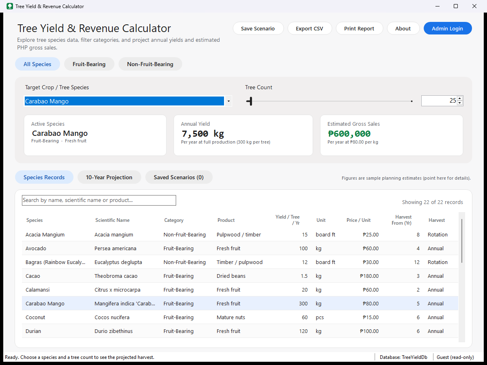

# Interactive Tree Database & Yield Calculator

An interactive desktop application for inspecting tree-species records, filtering them by type
(Fruit-Bearing / Non-Fruit-Bearing), and calculating projected harvest yields and estimated gross
sales in Philippine pesos.

Built with **Visual Basic .NET Windows Forms (.NET Framework 4.5.2)** and a **Microsoft Access
database (.mdb)** stored inside the project. It is a **Visual Studio 2015** solution and needs no
NuGet packages or database server.



---

## Features

| Area | What it does |
|---|---|
| Category filter | *All Species*, *Fruit-Bearing* and *Non-Fruit-Bearing* chips filter the drop-down and the records table. |
| Yield calculator | Pick a species, set the tree count (slider 1-1,000 or type up to 100,000) and see **Active Species**, **Annual Yield** and **Estimated Gross Sales** right away. |
| Species records | Searchable, sortable table of every record. Double-click (or press Enter) to inspect one record in full. |
| Multi-year projection | Year-by-year yield and sales for 1-30 years (default 10). Covers the non-bearing years, the ramp-up to full production, and one-time timber harvests. Shown as a chart and a table. |
| Saved scenarios | Save named calculations to the database and load them again later. Results are recalculated with current prices. |
| Export and print | Export to CSV (opens in Excel) or print a one-page report from a print preview. |
| Administrator area | Password login with lockout. Add, edit and delete species, view the audit log, change the password, restore the sample data. |

## Requirements

* Windows 7 SP1 or later (tested on Windows 11)
* .NET Framework 4.5.2 or later (Windows 10/11 already include it)
* Nothing else to install for the database: the program uses the **Microsoft Jet 4.0 OLE DB
  provider**, which is built into Windows. Jet is 32-bit only, so the program is built as **x86**.
* To open and edit the code: **Visual Studio 2015** (any edition, including Community) or newer.
* Optional: **Microsoft Access** (any version from 2000 on) to open and browse the database file.

## How to run

1. Open **`Interactive Tree Database\Interactive Tree Database.sln`** in Visual Studio 2015.
2. Press **F5**. *Interactive Tree Database* is the start-up project.
3. The program opens **`Interactive Tree Database\Interactive Tree Database\Database\TreeYieldDb.mdb`**.
   If the file is missing, it **creates it by itself**: tables, rules, relationships and 22 sample species.
4. To manage records, click **Admin Login** and use the default account:

   | Username | Password |
   |---|---|
   | `admin` | `admin0102` |

The built program is `Interactive Tree Database\Interactive Tree Database\bin\Debug\Interactive Tree Database.exe`.

## Solution structure

```
Interactive Tree Database/
  Interactive Tree Database.sln
  Interactive Tree Database/   Windows Forms application (presentation layer) - start-up project
    Forms/                     MainForm, LoginForm, AdminForm, SpeciesEditorForm, ...
    Controls/                  ChipButton, FlatSlider, StatCard, RoundedPanel (custom drawn)
    UI/                        Theme, GridStyler, ReportPrinter, ErrorReporter, AdminSession
    Database/TreeYieldDb.mdb   The Microsoft Access database
    ApplicationEvents.vb       Start-up and the global error handler
    AppServices.vb             Creates the services and repositories once
  TreeYield.Core/              Class library: business logic + data access (no UI)
    Models/                    TreeSpecies, Category, Scenario, YieldResult, ProjectionYear, ...
    Services/                  YieldCalculator (formulas), SpeciesValidator, AuthService,
                               PasswordHasher, CsvExporter, Formatters, ...
    Data/                      Repositories (parameterized OLE DB), DatabaseInitializer, SeedData
    Data/Scripts/Schema.sql    Access table definitions (embedded resource)
  TreeYield.Tests/             Console test runner: 94 unit + database integration tests
tools/Export-SourceCode.ps1    Regenerates docs/SOURCE_CODE.txt
docs/                          User manual, test cases, source-code soft copy, screenshots
```

**Three-layer architecture:** the Presentation layer (WinForms) calls the Business layer
(`Core/Services`), which calls the Data layer (`Core/Data`). Forms never contain SQL, and the
calculation code has no database or UI code, so it can be unit-tested.

## Calculation formulas

* **Annual yield** = tree count x yield per tree per year
* **Gross sales** = annual yield x price per unit
  (e.g. 25 Carabao Mango trees x 300 kg x PHP 80 = **7,500 kg** and **PHP 600,000**)
* **Projection, annual species:** 0 before the first harvest year, then a linear ramp up to full production:
  `factor = (year - first + 1) / (full - first + 1)`, capped at 100%.
* **Projection, rotation (timber) species:** nothing until rotation age, then a one-time harvest of
  `trees x mean annual increment x rotation age`. The projection assumes the land is replanted, so the
  harvest repeats every rotation.

All money and quantities use `Decimal`, never `Double`.

## Database

Six tables in the Access file `TreeYieldDb.mdb`: `Categories`, `TreeSpecies`, `Scenarios`, `Users`,
`AuditLog` and `SchemaVersion`. They have primary keys (AutoNumber), relationships with referential
integrity, unique indexes, validation rules (`CHECK` constraints) and *Cascade Delete Related Records*
from a species to its saved scenarios. The full script is in
`Interactive Tree Database/TreeYield.Core/Data/Scripts/Schema.sql`.

**Opening it in Microsoft Access:** close the program first (or at least do not edit the same record),
then double-click `TreeYieldDb.mdb`. *Database Tools > Relationships* shows the diagram. Do not open it
with *Open Exclusive* while the program runs; the program then shows a "database in use" message with
a Retry button.

**Fresh start:** close the program and delete or rename `TreeYieldDb.mdb`. The next start creates a new
file with the sample data and the default `admin` account.

## Security measures

* All SQL uses **parameters**, so text such as `' OR 1=1 --` is only ever treated as text (SQL injection is prevented).
* Passwords are stored as **PBKDF2 hashes** (100,000 iterations, random 16-byte salt) and compared in constant time.
* **Account lockout** for 5 minutes after 5 failed logins, with a generic "invalid username or password" message.
* **Forced password change** of the default account, a password policy, and a 15-minute admin idle timeout.
* An **audit log** of logins and changes. CSV export blocks **formula injection**.
* **Defense in depth:** input is validated in the UI, then in the service, then by the database's validation rules.

## Tests

Run `TreeYield.Tests`: in Visual Studio, right-click it and choose *Debug > Start New Instance*.
From the command line:

```
Interactive Tree Database\TreeYield.Tests\bin\Debug\TreeYield.Tests.exe              (all tests)
Interactive Tree Database\TreeYield.Tests\bin\Debug\TreeYield.Tests.exe --unit-only  (skip database tests)
```

The integration tests create a separate throw-away `.mdb` file in the Windows temp folder, so they
never touch your data. Manual test cases for the live demo are in `docs/TEST_CASES.txt`.

## Documentation

* `docs/USER_MANUAL.docx` / `docs/USER_MANUAL.txt`: step-by-step user manual
* `docs/TEST_CASES.txt`: test-case sheet for the live demonstration
* `docs/SOURCE_CODE.txt`: complete source code as one text file
* `docs/screenshots/`: screenshots of every screen

## About the data

The 22 sample species are **illustrative planning estimates** prepared for this school project. Real
yields and farm-gate prices vary with variety, site, management, weather and the market. Check with the
Department of Agriculture (DA), the Philippine Statistics Authority (PSA) or local buyers. An
administrator can update any figure.
